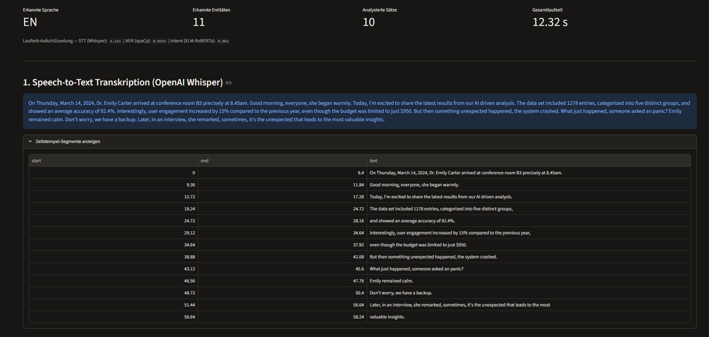
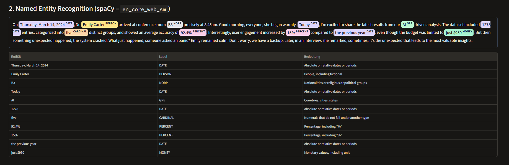
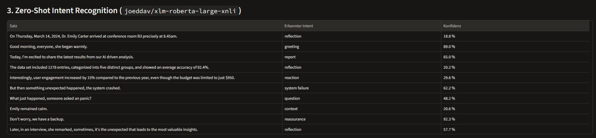

# Multilingual Voice-NLU Pipeline

Eine modulare End-to-End-Anwendung für **Speech-to-Text (STT)** und **Natural Language Understanding (NLU)** in **Deutsch und Englisch**. Das Projekt überführt Modell-Benchmarks aus den Bereichen Text-to-Speech (TTS), Spracherkennung (STT) und Sprachverständnis (NLP/NLU) in eine produktionsnahe Python-Architektur mit interaktiver **Streamlit-Oberfläche**.

---

## Vorschau der Anwendung

### 1. KPI-Übersicht & Speech-to-Text (OpenAI Whisper)


<details>
<summary><b>Weitere Ansichten anzeigen: Named Entity Recognition (spaCy) & Intent-Analyse (XLM-RoBERTa)</b></summary>
<br>

**2. Named Entity Recognition (`spaCy`)**


**3. Zero-Shot Intent Recognition (`joeddav/xlm-roberta-large-xnli`)**


</details>

---

## Architektur & Datenfluss

Die Pipeline verarbeitet gesprochene Sprache (oder direkte Texteingaben) lokal über drei aufeinander abgestimmte KI-Stufen:

```text
Audio-Input (.wav, .mp3, .m4a, .ogg)
        │
        ▼
┌───────────────────────────────────────────┐
│ 1. Speech-to-Text (OpenAI Whisper)        │  ──► Transkript, Segmente & Spracherkennung (DE/EN)
└───────────────────────────────────────────┘
        │
        ▼
┌───────────────────────────────────────────┐
│ 2. Named Entity Recognition (spaCy)       │  ──► Personen, Orte, Organisationen, Daten, Zahlen
└───────────────────────────────────────────┘
        │
        ▼
┌───────────────────────────────────────────┐
│ 3. Zero-Shot Intent (XLM-RoBERTa-XNLI)    │  ──► Satzweise Absichtserkennung ohne Nachtraining
└───────────────────────────────────────────┘
        │
        ▼
  Streamlit UI / JSON-Output
```

---

## Modellauswahl & Benchmark-Erkenntnisse

Vor dem Aufbau der produktiven Pipeline wurden verschiedene Modelle für Deutsch und Englisch evaluiert (dokumentiert im Ordner `notebooks/`):

| Stufe | Evaluierte Ansätze | Produktive Wahl | Begründung |
| :--- | :--- | :--- | :--- |
| **Testdaten (TTS)** | Edge-TTS, PiperTTS, Tacotron 2 (DE/EN) | **Edge-TTS** (Referenz-Audios) | Beste Sprachqualität und korrekte Aussprache von Zahlen/Abkürzungen zur Erzeugung reproduzierbarer Referenz-Audios. |
| **Speech-to-Text** | Coqui STT, Silero STT, Vosk, **OpenAI Whisper** | **OpenAI Whisper (`base`)** | Beste Erkennungsqualität bei Interpunktion, Zahlen und Eigennamen in beiden Sprachen ohne aufwendige Format-Konvertierung. |
| **Entity Extraction** | spaCy (`de_core_news_sm`, `en_core_web_sm`) | **spaCy (DE & EN)** | Schnelle, zuverlässige Extraktion strukturierter Entitäten und präzise Satzsegmentierung. |
| **Intent & Sentiment** | VADER Sentiment, **XLM-RoBERTa Zero-Shot** | **`joeddav/xlm-roberta-large-xnli`** | VADER ist auf ein englisches Lexikon beschränkt; XLM-RoBERTa klassifiziert beliebige Intents mehrsprachig (DE/EN) ohne Trainingsdaten. |

---

## Projektstruktur

```text
multilingual-voice-nlu-pipeline/
├── app.py                              # Interaktive Streamlit-Webanwendung
├── requirements.txt                    # Python-Abhängigkeiten
├── README.md                           # Projektdokumentation
├── .gitignore                          # Ausschluss lokaler Umgebungen & temporärer Dateien
│
├── src/                                # Modulares Python-Backend
│   ├── __init__.py
│   ├── stt_whisper.py                  # Audio-Transkription & Spracherkennung mit Whisper
│   ├── nlu_ner.py                      # Named Entity Recognition & Satz-Splitting mit spaCy
│   ├── nlu_intent.py                   # Zero-Shot Intent-Klassifizierung mit XLM-RoBERTa
│   └── pipeline.py                     # End-to-End Orchestrierung (Audio & Text)
│
├── scripts/                            # Hilfsskripte für Setup & Testdaten
│   └── generate_sample_audio.py        # Erzeugt sample_de.wav & sample_en.wav aus reference_texts.json
│
├── notebooks/                          # Evaluierungs- & Benchmark-Notebooks
│   ├── 01_tts_benchmark.ipynb          # Vergleich der TTS-Synthese-Engines
│   ├── 02_stt_benchmark.ipynb          # Praxisvergleich: Coqui, Silero, Vosk & Whisper
│   └── 03_nlu_evaluation.ipynb         # Analyse von spaCy NER, XLM-RoBERTa & VADER
│
├── docs/                               # Screenshots für die Projektdokumentation
│   ├── 01_whisper_overview.png
│   ├── 02_spacy_ner.png
│   └── 03_intent_recognition.png
│
└── data/
    ├── reference_texts.json            # Zentrale DE/EN-Referenztexte & Standard-Intents
    └── sample_audio/                   # Beispiel-Audiodateien (sample_de.wav, sample_en.wav)
```

---

## Installation & Setup

### 1. Systemvoraussetzung: `ffmpeg`
OpenAI Whisper sowie die Audio-Konvertierung benötigen `ffmpeg`:
- **Windows (via winget):** `winget install Gyan.FFmpeg`
- **macOS (via Homebrew):** `brew install ffmpeg`
- **Linux (Ubuntu/Debian):** `sudo apt update && sudo apt install ffmpeg`

### 2. Repository klonen & virtuelle Umgebung einrichten
```bash
git clone https://github.com/xdennis090/multilingual-voice-nlu-pipeline.git
cd multilingual-voice-nlu-pipeline

python -m venv .venv
```

**Aktivieren der Umgebung:**
- **Windows (PowerShell):** `.venv\Scripts\Activate.ps1`
- **Linux / macOS:** `source .venv/bin/activate`

### 3. Abhängigkeiten & Sprachmodelle installieren
```bash
pip install -r requirements.txt

python -m spacy download de_core_news_sm
python -m spacy download en_core_web_sm
```

### 4. Referenz-Audiodateien prüfen / neu generieren (optional)
Die beiden Standard-Audios (`data/sample_audio/sample_de.wav` und `data/sample_audio/sample_en.wav`) sind bereits im Repository enthalten. Falls du die Texte in `data/reference_texts.json` anpasst oder die Dateien neu erzeugen möchtest, führe aus dem Hauptverzeichnis aus:

```bash
python scripts/generate_sample_audio.py
```

---

## Anwendung starten

Starte die Streamlit-Oberfläche aus dem Hauptverzeichnis:

```bash
streamlit run app.py
```

Die Weboberfläche öffnet sich unter `http://localhost:8501` und bietet zwei Modi:
1. **Audio-Analyse (End-to-End):** Upload eigener Audiodateien (`.wav`, `.mp3`, `.m4a`, `.ogg`) oder Auswahl der hinterlegten Beispiel-Audios (`sample_de.wav`, `sample_en.wav`) aus `data/sample_audio/`.
2. **Text-Analyse (NLU-Test):** Direktes Testen der NER- und Intent-Stufe anhand der vordefinierten deutschen und englischen Referenztexte oder eigener Eingaben.

In der Seitenleiste lassen sich Whisper-Modellgröße (`tiny`, `base`, `small`), Sprachvorgabe sowie die Kandidaten-Intents live anpassen.

---

## Programmatische Nutzung (Python API)

Das Backend in `src/` ist unabhängig von Streamlit nutzbar:

```python
from src.pipeline import run_voice_nlu_pipeline, run_text_nlu_pipeline

# 1. Vollständige Audio-Pipeline
voice_result = run_voice_nlu_pipeline(
    audio_path="data/sample_audio/sample_de.wav",
    whisper_size="base",
)
print("Transkript:", voice_result["text"])
print("Entitäten:", voice_result["ner"]["entities"])
print("Intents:", voice_result["intents"]["predictions"])

# 2. Reine Text-NLU-Pipeline
text_result = run_text_nlu_pipeline(
    text="Don't worry, we have a backup.",
    language="en",
    candidate_labels=["greeting", "question", "reassurance", "system failure"],
)
print(text_result["intents"]["predictions"])
```

---

## Datenschutz & Lokale Ausführung

Alle eingesetzten KI-Modelle der Analyse-Pipeline (**Whisper**, **spaCy**, **XLM-RoBERTa**) werden vollständig lokal auf der eigenen Hardware (CPU oder CUDA-GPU) ausgeführt – es werden keine Sprachaufnahmen oder Transkripte an externe Cloud-APIs übertragen. Lediglich das optionale Hilfsskript `scripts/generate_sample_audio.py` (sowie der optionale Live-Test in `notebooks/01_tts_benchmark.ipynb`) greift zur einmaligen Synthese synthetischer Testdaten auf Microsoft Edge-TTS zu.